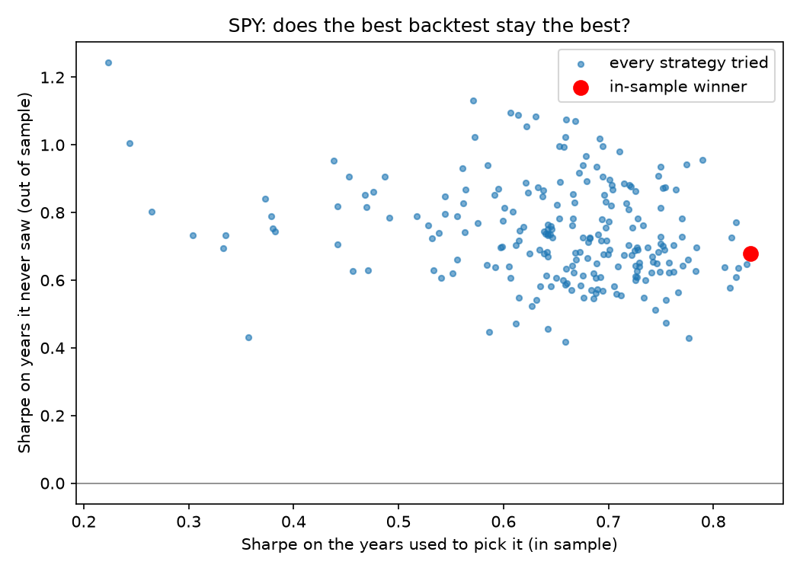

# backtest-overfitting

Tests whether a trading strategy's backtest holds up on data it never saw.

Search enough strategies and one of them will look brilliant on past data by
chance. In machine learning this is overfitting. This tool measures it on real
market data, with four checks:

1. **Out-of-sample test.** Tune 224 moving-average crossover strategies on the
   first 70% of the data, pick the best, then score every one of them on the
   last 30%, which none of them were tuned on.
2. **Permutation test.** Shuffle the daily returns 300 times and re-run the
   *whole* search on each shuffle. If the real winner is no better than the
   winners found in shuffled data, its edge is consistent with luck. Re-running
   the search, rather than only testing the winner, accounts for having tried
   224 strategies and kept the best.
3. **A machine learning strategy.** Logistic regression on the last five daily
   returns, trained by gradient descent written from scratch in numpy, put
   through the same tests.
4. **Monte Carlo.** 1,000 simulated ten-year price paths with the same average
   and volatility, drawn from a normal distribution and from a fat-tailed
   Student-t, to see how much the strategy's worst case depends on that
   assumption.

## Results

Daily total returns, January 2005 to December 2025, for three US index funds.
Sharpe ratios are annualised. Run with `uv run backtest-overfitting SPY`.

| Fund | Buy and hold, out of sample | In-sample winner: tuned | ... then out of sample | Its rank out of sample | Permutation p |
|---|---|---|---|---|---|
| SPY (S&P 500) | 0.82 | 0.84 | 0.68 | 142 / 224 | 0.08 |
| QQQ (Nasdaq 100) | 0.89 | 0.85 | 0.93 | 99 / 224 | 0.25 |
| IWM (Russell 2000) | 0.46 | 0.54 | 0.30 | 88 / 224 | 0.63 |

**The best backtest did not stay the best.** On the years it never saw, the
winner ranked in the middle of the pack every time, and lost to simply holding
the fund on two of the three. None of the three passed the permutation test at
the 5% level.



**The machine learning model fooled the first test.** On SPY it beat buy and
hold out of sample with a permutation p-value of 0.003. Looking closer, it was
in the market 99% of the time and simply stepped aside after big moves. Big
moves cluster together, and shuffling returns destroys that clustering, so the
shuffle test overstated its skill. Against a fairer null that sits out the same
number of days chosen at random from days after big moves, p rose to 0.02, and
the effect did not appear at all on QQQ (p = 1.0) or IWM (p = 0.36). One
borderline result on one fund out of three is weak evidence.

**Fat tails changed the worst day, not the worst year.** With the same
volatility, the median worst single day was about 2.6 times larger under fat
tails (around -11% against -4% on SPY), but the strategy's 95th-percentile
drawdown over ten years barely moved (47% in both). Over many days the losses
add up to roughly the same total. A model that treats each day as independent
misses what really drives crashes: bad days arriving together.

## Limits

- Three funds and one train/test split. A walk-forward test would be stronger.
- No trading costs, which would make every active strategy look worse.
- The Monte Carlo draws each day independently, so it cannot produce
  volatility clustering. That is the next thing to model.

## Run it

```
uv sync
uv run backtest-overfitting SPY # writes results/SPY/
uv run pytest
```
